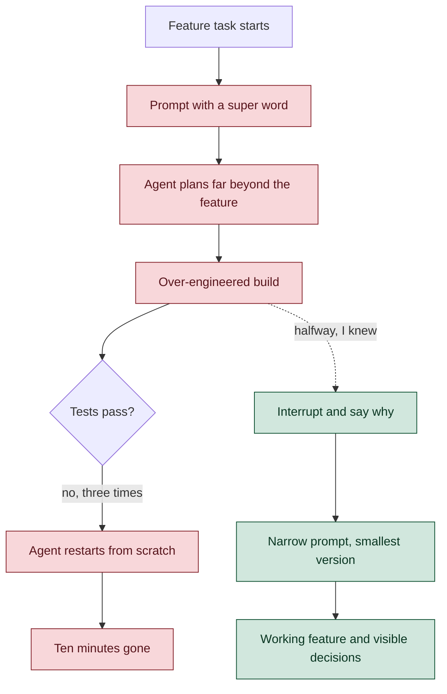

I lost a final-round interview to a single prompt. It ran for ten minutes, built far more than the task asked for, failed three times and started over, while I watched a clock I hadn't planned for. In the same hiring process I passed a harder coding round and a system design interview full of sagas and sharded databases. None of that made up for those ten minutes. Here's what an AI-agent interview actually measures, how mine went wrong, and the six rules I'd follow next time.

---

## A coding interview where the agent writes the code

Over the last year I've done plenty of interviews, but never a live coding round with an AI agent in the loop. I didn't know what would be evaluated, so I had a quick call with the recruiting team to clear up my doubts before the day.

I got one hour, an existing full-stack codebase in a browser IDE, and a coding agent running in its terminal. There were two tasks of roughly twenty minutes each, first find and fix a bug, then build a feature, with a few minutes for questions at the end. The agent writes the code while the interviewer grades the person steering it.

They wanted to see how I worked with the agent, how I planned, debugged and made decisions end to end. One good prompt wouldn't prove much. What counted was the way a candidate thinks and decides across the whole session while a tool does the typing. The preparation email from the recruiting team spelled out the criteria.

```daisyui
{
  "component": "callout",
  "variant": "information",
  "title": "What the round scored",
  "ariaLabel": "Evaluation criteria for the agentic coding round",
  "content": [
    { "type": "paragraph", "text": "Prompt and plan first, with clear constraints and plan mode before any code. Act as the supervisor and never accept generated code blindly. Write tests early to catch edge cases and hallucinations. Narrate your reasoning out loud the whole time." }
  ]
}
```

Platforms built for this format can also hand the hiring team a transcript of the whole agent session. Whoever reviews it can follow the process behind your final code, prompt by prompt, so every decision you make with the agent, or fail to make, ends up on the record.

---

## I already work this way

None of this worried me much. I just needed to work the way I already work. My routine with agents is settled. I start in plan mode, write well-scoped prompts, and follow a test-driven loop where the agent writes a failing test before it touches the code. I use Claude Code for most of it.

I trust that routine because I've shipped with it. I built an entire product with an agent, the disciplined kind of vibe coding where every change goes through a plan, a test and a review, [Ravnary](/projects/ravnary/). Walking into the round, the format sounded like a normal workday with someone watching, and I honestly expected it to be a no-brainer.

---

## The clock I never drew

What I didn't plan for was time. I was so focused on showing my workflow that I never thought about the agent's share of the clock. Planning, testing and reviewing all felt like my time to spend, and I assumed the agent's work would fit in the gaps.

An agent runs on wall-clock minutes you don't control. A focused prompt comes back quickly. A loose one can eat a large slice of the task before you notice, and when it goes wrong it can take far longer than you'd expect. Nothing in the preparation material said the agent spends the same minutes you do, and I never asked.

```echart
{
  "type": "donut",
  "figure": {
    "title": "Where the feature task's 20 minutes went",
    "description": "Donut chart. One prompt took 10 of the roughly 20 minutes the feature task had, leaving about 10 minutes for everything else."
  },
  "size": { "width": 760, "height": 360 },
  "data": {
    "name": "Feature task",
    "data": [
      { "name": "One prompt", "value": 10 },
      { "name": "Everything else", "value": 10 }
    ]
  }
}
```

---

## Ten minutes, one prompt

The trouble came with the feature task. I prompted the way I usually do at work, and that was the mistake. My prompt carried what I call a super word, a keyword that tells the agent to think much harder and longer before it acts.

The agent took that literally. It planned far beyond what the feature needed, designed an over-engineered solution, failed its own run three times and restarted the whole process from scratch. The single prompt took ten minutes, about half the time the task had.

The diagram below puts what happened next to what I should have done the moment I saw the run going wrong.



Halfway through I knew I'd made a mistake. I even said so out loud to the interviewer. And then I let it keep running, because stopping felt riskier than waiting. That decision, or rather the lack of one, cost me the round.

The feedback was short and fair. They couldn't evaluate whether I knew how to use agents in my workflow, which is the thing I do every day.

---

## Why I didn't stop it

The failure I know best from working with coding agents is plausible code nobody asked for, the kind you keep because it looks like it works. Over-engineering is its most expensive form. I recognized the pattern while it was happening and still didn't act on it.

I froze for ordinary reasons. Interrupting looked like admitting my approach had failed. The longer the agent ran, the more stopping felt like throwing those minutes away, so I kept hoping the next attempt would land. With someone watching, waiting felt like the safe move.

In this format waiting costs the most, because **stopping the agent is part of what gets scored**. An interrupt with a stated reason is a decision the interviewer can see. The round was built to observe decisions, and the one I needed to make was the one I skipped.

---

## Six rules for racing the clock

If you're about to face an interview like this, remember you're racing the clock as much as solving the task, and the agent spends that clock too. These are the rules I'd follow next time, in the order I'd apply them.

```daisyui
{
  "component": "list",
  "ariaLabel": "Six rules for AI-agent coding interviews",
  "class": "my-8 shadow-sm",
  "items": [
    {
      "title": "Plan for time, not just quality",
      "subtitle": "Put the agent on your clock",
      "description": "Give every prompt a budget. If an agent run shows no visible progress after two or three minutes, treat it as over budget and act.",
      "media": { "kind": "marker", "label": "1" }
    },
    {
      "title": "Avoid keywords that trigger extended thinking",
      "subtitle": "Save deep reasoning for the conversation",
      "description": "Long-thinking modes belong in design questions you can discuss with the interviewer, not in code that has to run inside twenty minutes.",
      "media": { "kind": "marker", "label": "2" }
    },
    {
      "title": "Write prompts that keep the agent focused",
      "subtitle": "Files, done criterion, verification",
      "description": "Name the files in scope, say what done looks like, and give the command that proves it. A short, specific prompt finishes faster than a clever one.",
      "media": { "kind": "marker", "label": "3" }
    },
    {
      "title": "Don't let the agent wander",
      "subtitle": "Fence the scope out loud",
      "description": "Tell it what you're not building, and reject out-of-scope diffs with a reason. The interviewer hears the decision, and the agent stays on task.",
      "media": { "kind": "marker", "label": "4" }
    },
    {
      "title": "Lower the effort level",
      "subtitle": "Working beats well designed and unfinished",
      "description": "Ask for the smallest thing that passes the tests first. You can describe the better design out loud once the simple version is green.",
      "media": { "kind": "marker", "label": "5" }
    },
    {
      "title": "If it's going wrong, stop it early",
      "subtitle": "The interrupt is the evidence",
      "description": "Interrupt, rewind, narrow the prompt, and narrate why. That narration is exactly what the interviewer needs to see you lead the agent.",
      "media": { "kind": "marker", "label": "6" }
    }
  ]
}
```

---

## The rounds I passed

In the same process I passed a harder LeetCode-style round and a system design interview. In the design round I covered CQRS, a ledger, message queues, the outbox pattern, caching, an API gateway, load balancers, sagas, idempotency keys, and database sharding with tools like ZooKeeper. Then I mapped the design onto AWS and defended the trade-offs of each choice.

- Cognito for identity, with Lambda, Fargate and EC2 for compute and an ALB for horizontal scaling.
- EventBridge, SQS FIFO, Kinesis and Step Functions for events, ordering, streams and long-running workflows.
- DynamoDB, Aurora and RDS for storage, with CloudWatch watching all of it.

None of that mattered. In a loop like this each round is scored on its own, and a strong design hour doesn't buy back an hour where the evidence never appeared. A 10-minute prompt carried the same weight as all of it.

I still work the way I described at the start, plan mode, scoped prompts and tests first. The difference now is that every agent run gets a time budget, at work too, and I stop the ones that blow through it.
